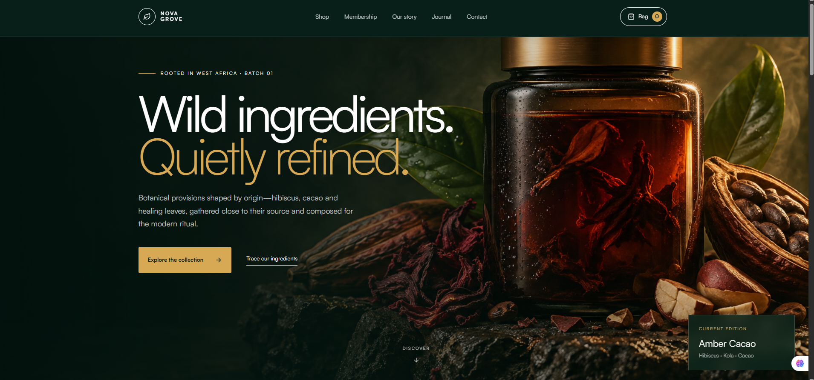

# Nova Grove

**Wild ingredients. Quietly refined.**

A premium, multi-page botanical brand website inspired by West African ingredients, considered rituals, and editorial design. Nova Grove combines a product storefront with a digital membership concept, using cinematic imagery, Satoshi typography, and a forest-green, cream, and gold visual identity.

[View website](https://nova-grove.maajolawasanjo.chatgpt.site) · [Report an issue](https://github.com/Maajolawasanjo/Nova-grove/issues)



## Overview

This repository contains the website’s source code, image assets, reusable components, styles, and build configuration. It is a working frontend prototype with separate page routes and browser-persisted shopping-bag interactions.

**Commerce and membership services are not connected yet.** The site demonstrates the customer experience; it does not currently process payments, create subscriptions, or deliver contact messages.

## Features

- Dedicated home, shop, product-detail, membership, story, journal, and contact pages.
- Responsive layouts with desktop navigation and a mobile navigation drawer.
- Persistent navigation, page-scroll progress, and a back-to-top control.
- Product quantity selection, add-to-bag actions, item removal, and calculated totals.
- Shopping-bag persistence in browser local storage.
- Contact form with native field validation and a frontend confirmation state.
- Full-height homepage hero artwork with layered gradients and responsive positioning.
- Shared header, footer, cart state, and reusable UI components.

## Pages

| Route | Purpose |
| --- | --- |
| `/` | Brand introduction, featured provisions, philosophy, and rituals |
| `/shop` | Botanical product collection |
| `/shop/cacao-no-04` | Cacao No. 04 product details |
| `/shop/hibiscus-no-07` | Hibiscus No. 07 product details |
| `/shop/moringa-no-11` | Moringa No. 11 product details |
| `/membership` | The Grove membership offer and benefits |
| `/story` | Brand story and sourcing narrative |
| `/journal` | Editorial journal landing page |
| `/contact` | Enquiry form and contact information |

Product pages use the dynamic route `app/shop/[slug]/page.tsx`. Currently, an unrecognised product slug falls back to Cacao No. 04 rather than returning a 404.

## Technology

| Area | Implementation |
| --- | --- |
| UI | React 19 and TypeScript |
| Application framework | Vinext with Next.js App Router conventions |
| Build tooling | Vite 8 |
| Styling | Tailwind CSS 4 and custom CSS |
| Components | shadcn-style components, Radix UI, and Base UI |
| Icons | Lucide React |
| Typography | Satoshi, loaded through Fontshare |
| Production runtime | Cloudflare Worker through the included Sites configuration |
| Package manager | pnpm 11.25.0 |
| Optional data tooling | Drizzle ORM and Cloudflare D1 scaffolding |

The presence of Next.js dependencies does not make this a conventional `next build` deployment. Use the repository’s scripts, which run Vinext/Vite and produce a Worker build.

## Getting started

### Requirements

- Node.js **22.13.0 or newer**
- pnpm **11.25.0**
- Git
- Internet access for dependency installation and externally hosted fonts/assets

### Installation

```sh
git clone https://github.com/Maajolawasanjo/Nova-grove.git
cd Nova-grove
npm install --global pnpm@11.25.0
pnpm install --frozen-lockfile
pnpm dev
```

Open the URL printed in the terminal. The portable development profile defaults to **http://localhost:5173**.

A fresh clone automatically uses the portable execution profile. No private API keys or database setup are required for the current storefront UI.

### Commands

| Command | Purpose |
| --- | --- |
| `pnpm dev` | Start the development server |
| `pnpm build` | Create the production Worker build |
| `pnpm start` | Preview the built Worker locally using Wrangler |
| `pnpm lint` | Run ESLint |
| `pnpm db:generate` | Generate migrations for optional Drizzle schema changes |

To preview the production build locally:

```sh
pnpm build
pnpm start
```

Use the address printed by Wrangler. **`pnpm start` does not deploy the site.**

## Project structure

| Path | Responsibility |
| --- | --- |
| `app/` | Page routes, root layout, metadata, and styles |
| `app/page.tsx` | Homepage composition and featured-product interaction |
| `app/globals.css` | Base styles, brand tokens, typography, and hero background |
| `app/shop/[slug]/page.tsx` | Product-detail data and rendering |
| `components/site-header.tsx` | Navigation, mobile menu, and shopping-bag drawer |
| `components/site-footer.tsx` | Shared footer |
| `components/cart-context.tsx` | Cart state, totals, and local-storage persistence |
| `components/product-purchase.tsx` | Product quantity and add-to-bag controls |
| `components/contact-form.tsx` | Contact-form UI and confirmation state |
| `components/scroll-navigation.tsx` | Scroll progress and back-to-top behaviour |
| `components/ui/` | Reusable UI primitives |
| `public/` | Hero image, favicon, and other static assets |
| `scripts/` | Installation, runtime-profile, and build helpers |
| `build/` | Sites integration for Vite |
| `db/` and `examples/d1/` | Optional database scaffolding and examples |
| `vite.config.ts` | Vinext, Sites, and Cloudflare integration |
| `.openai/hosting.json` | Original Sites project association and optional bindings |
| `FRAMEWORK_NOTES.md` | Original framework and hosting reference notes |

## Design and customisation

The core palette is defined in `app/globals.css`:

| Token | Colour | Use |
| --- | --- | --- |
| `--forest` | `#071F18` | Dark brand surfaces |
| `--ink` | `#10271F` | Primary text |
| `--paper` | `#F7F3E9` | Light page surfaces |
| `--cream` | `#F1EADC` | Warm supporting surfaces |
| `--gold` | `#D7A955` | Accents and emphasis |

- **Typography:** update the Fontshare import and font declarations in `app/globals.css`.
- **Hero artwork:** replace `public/nova-grove-hero.png` and adjust the `.hero` background rules. The image and gradients belong to the hero section itself.
- **Products:** keep the homepage selection, shop listing, and product-detail data consistent when changing names, prices, or slugs.
- **Membership:** edit the offer and benefits in `app/membership/page.tsx`.
- **Metadata:** update the title, description, and favicon configuration in `app/layout.tsx`.

Additional styles are imported by the root layout. Check those imports when changing a rule that appears to be overridden.

## Current implementation boundaries

| Area | Current behaviour |
| --- | --- |
| Shopping bag | Stored locally under `nova-grove-cart`; no account or cross-device sync |
| Checkout | “Continue to delivery” is present, but no checkout handler is connected |
| Payments and orders | No payment gateway, order storage, or fulfilment integration |
| Membership | Offer page links to contact; no subscription billing or member portal |
| Contact form | Shows a local success state; does not send or save the message |
| Product content | Defined in source code; no CMS or inventory service |
| Database | D1 and R2 bindings are currently unset |
| Authentication | Framework helpers are included; customer accounts are not implemented |

Product descriptions, prices, delivery promises, and membership terms are prototype content and should be reviewed before a commercial launch.

## Deployment

The existing build targets the Sites/Cloudflare Worker runtime. The generated Worker configuration is located at `dist/server/wrangler.json` after a successful build.

- For the original Sites project, use its publishing workflow.
- For independent Cloudflare hosting, configure the target account, Worker, domain, and any required bindings.
- For Vercel or another platform, adapt the framework/runtime configuration before deploying.

Pushing to GitHub alone does not deploy changes to the original website. The `.openai/hosting.json` file identifies the original Sites project; it is not an access credential. Review that association when creating a separate deployment.

## Validation

The source version exported to this repository completed a production build before upload. This is not a claim that every interaction or third-party deployment has been tested.

There is no automated test script configured. After UI changes, check desktop and mobile layouts, navigation, product selection, cart persistence, scrolling controls, and form states.

## Contributing

Open an issue describing the proposed change, or submit a focused pull request. Preserve the visual system, document changes to user-facing behaviour, and run the relevant build/lint checks.

Never commit credentials, local environment files, generated build output, or dependency directories.

## License

No project-wide open-source license has been added. Public repository visibility alone does not grant an open-source license. Included third-party license notices remain applicable to their respective files.
